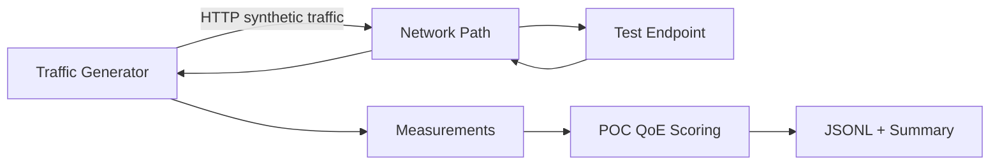

# Claude Code Handoff — Onboard Network QoE Simulator POC

## 1. Purpose

Build a small Python proof of concept that demonstrates how synthetic passenger-like network traffic can be generated, sent through a network, measured, and converted into useful observations.

This POC is not intended to reproduce the complete production solution. Its purpose is to validate the technical direction and give us something concrete to experiment with.

The broader project aims to move beyond infrastructure-only metrics such as latency and packet loss and understand how network conditions affect activities such as web browsing, streaming, and communication. Eventually, this may run from hardware or routers onboard trains and report results to a centralized fleet-level monitoring system.

For this POC, keep everything runnable on a developer machine or small Linux device.

---

## 2. POC Scope

Implement two Python components:

1. **Test Endpoint**
   - A lightweight HTTP API that behaves like a controllable remote internet service.
   - Allows us to simulate different response sizes, delays, errors, and simple streaming/download scenarios.

2. **Traffic Generator**
   - Sends configurable HTTP traffic to the test endpoint.
   - Supports multiple simple traffic profiles that approximate passenger activities.
   - Records measurements for each request.
   - Produces a summarized result after a test run.

Do not build a frontend, fleet dashboard, cloud infrastructure, authentication system, database, or actual router integration in this POC.

---

## 3. Recommended Technology

Use:

- Python 3.12+
- FastAPI
- Uvicorn
- httpx with async support
- Pydantic
- asyncio
- pytest
- Optional: psutil for local host resource measurements

Prefer standard Python libraries where possible.

Use `pyproject.toml` for dependency and project configuration.

---

## 4. Important Technical Interpretation

For this POC, the phrase **traffic/packet generator** should be implemented as an **application-level synthetic traffic generator**.

Generate real HTTP requests over TCP/IP rather than manually crafting low-level IP/TCP packets.

This is intentional because the immediate research question is closer to:

> What does the end-user experience look like when different types of application traffic travel through the onboard network?

Low-level packet generation using tools such as Scapy may be explored later if required for network-layer testing.

---

## 5. Suggested Repository Structure

```text
onboard-qoe-poc/
├── README.md
├── pyproject.toml
├── .gitignore
├── app/
│   ├── __init__.py
│   ├── test_server/
│   │   ├── __init__.py
│   │   └── main.py
│   └── traffic_generator/
│       ├── __init__.py
│       ├── main.py
│       ├── config.py
│       ├── models.py
│       ├── profiles.py
│       ├── runner.py
│       ├── metrics.py
│       └── reporter.py
├── configs/
│   └── example.yaml
├── output/
│   └── .gitkeep
└── tests/
    ├── test_server.py
    ├── test_profiles.py
    └── test_metrics.py
```

Keep the code modular but simple.

---

## 6. Test Endpoint Requirements

Create a FastAPI application.

### Health Endpoint

```http
GET /health
```

Response:

```json
{
  "status": "ok"
}
```

### Simulated Web Page

```http
GET /page
```

Query parameters:

- `delay_ms`: artificial server-side delay
- `size_kb`: approximate response payload size
- `status_code`: optional HTTP status code

Example:

```http
GET /page?delay_ms=200&size_kb=100
```

The endpoint should generate a payload of approximately the requested size.

### Download Endpoint

```http
GET /download
```

Query parameters:

- `size_kb`
- `delay_ms`

Return binary or generated content of approximately the requested size.

This allows basic throughput measurements.

### Streaming Endpoint

```http
GET /stream
```

Query parameters:

- `chunks`
- `chunk_size_kb`
- `interval_ms`

Return a `StreamingResponse`.

The server should emit chunks progressively so the traffic generator can measure whether data delivery is smooth.

### Failure Endpoint

```http
GET /failure
```

Query parameters:

- `status_code`
- `delay_ms`

This is useful for validating failure-rate calculations.

---

## 7. Traffic Profiles

Implement profiles as Python classes/functions that describe request behavior.

Start with the following.

### Profile: Web Browsing

Simulates a user loading small/medium web resources.

Example behavior:

- GET `/page`
- payload: 50–500 KB
- randomized think time between requests
- low request concurrency

Metrics of interest:

- request latency
- success/failure
- payload size
- throughput

### Profile: Download

Simulates downloading larger content.

Example behavior:

- GET `/download`
- 1–10 MB payloads for the POC

Metrics:

- total transfer time
- bytes downloaded
- effective Mbps

### Profile: Streaming

Simulates a simple streaming-like flow using `/stream`.

Metrics:

- time to first byte
- total stream duration
- received chunks
- expected vs received bytes
- gaps between chunks where practical

Do not attempt to emulate Netflix protocols, DRM, adaptive bitrate algorithms, or copyrighted service traffic.

The profile only needs to approximate the network behavior of a streaming workload.

---

## 8. Generator Configuration

Support configuration through a YAML file.

Example:

```yaml
target:
  base_url: "http://localhost:8000"

run:
  duration_seconds: 30
  concurrent_users: 5
  request_timeout_seconds: 10
  max_requests_per_second: 20

profile:
  type: "web_browsing"
  min_delay_ms: 100
  max_delay_ms: 1000
  min_payload_kb: 50
  max_payload_kb: 500

metadata:
  device_id: "poc-device-001"
  train_id: "train-poc-001"
  journey_id: "journey-poc-001"
```

Validate the configuration using Pydantic.

The generator must enforce the configured maximum request rate.

The default configuration must be conservative and suitable for localhost testing.

---

## 9. Per-Request Measurement Model

Capture at least:

```text
timestamp
test_run_id
device_id
train_id
journey_id
profile
request_id
url
http_method
status_code
success
latency_ms
time_to_first_byte_ms
bytes_received
transfer_duration_ms
throughput_mbps
error
```

Not every field has to be populated for every request.

Use monotonic/performance timers for duration measurements.

---

## 10. Test Run Summary

At the end of a run, calculate:

- total requests
- successful requests
- failed requests
- success percentage
- average latency
- minimum latency
- maximum latency
- p50 latency
- p95 latency
- p99 latency
- total bytes received
- average throughput Mbps
- test duration

For streaming runs, also summarize:

- streams started
- streams completed
- incomplete streams
- average time to first byte

Write:

```text
output/<test-run-id>-requests.jsonl
output/<test-run-id>-summary.json
```

JSONL is preferred for individual request records because it will be easy to ingest into a monitoring or analytics system later.

---

## 11. Simple POC QoE Score

Add an intentionally simple experimental QoE score from `0` to `100`.

This is only for demonstrating the concept. It must be clearly labelled as a **POC heuristic**, not a scientifically validated QoE model.

Start with three dimensions:

- latency score
- reliability score
- throughput score

Example conceptual weighting:

```text
QoE =
    latency_score * 0.40 +
    reliability_score * 0.35 +
    throughput_score * 0.25
```

Implement scoring rules in one isolated module so they can easily be replaced.

Include the component scores in the output:

```json
{
  "qoe_score": 82.4,
  "qoe_model": "poc-v1",
  "components": {
    "latency": 78.0,
    "reliability": 95.0,
    "throughput": 72.0
  }
}
```

Do not present this score as objectively representing passenger satisfaction.

---

## 12. CLI

Provide commands similar to:

### Start test endpoint

```bash
uv run uvicorn app.test_server.main:app --host 0.0.0.0 --port 8000
```

### Run traffic generator

```bash
uv run python -m app.traffic_generator.main --config configs/example.yaml
```

Optional CLI overrides are useful:

```bash
uv run python -m app.traffic_generator.main \
  --config configs/example.yaml \
  --duration 60 \
  --users 10
```

---

## 13. Console Output

While a test is running, display simple progress information such as:

```text
Run: 5af8...
Profile: web_browsing
Elapsed: 12.4s / 30s
Requests: 96
Success: 94
Failed: 2
Current Avg Latency: 184 ms
```

At completion print a compact summary.

Do not build a terminal dashboard unless it remains very simple.

---

## 14. Safety / Boundaries

This POC is for controlled research and testing.

Implement the following protections:

- conservative default request rate
- explicit `max_requests_per_second`
- explicit concurrency limit
- request timeout
- finite test duration
- graceful cancellation with Ctrl+C
- no IP scanning
- no port scanning
- no random target discovery
- no proxy rotation
- no bypass/evasion behavior
- no raw packet flood implementation
- no unbounded load mode

The generator should operate only against a target explicitly supplied in configuration.

Document that users must only generate traffic against systems/networks they are authorized to test.

---

## 15. Tests

Add automated tests for at least:

- configuration validation
- percentile calculations
- throughput calculation
- QoE heuristic
- FastAPI health endpoint
- payload endpoint behavior
- profile creation

Tests should not require external internet access.

---

## 16. README

The README should explain:

1. Objective of the POC
2. Architecture
3. Setup
4. Starting the test endpoint
5. Running the traffic generator
6. Configuration options
7. Output files
8. Meaning and limitations of the QoE score
9. Safety restrictions
10. Potential next research steps

Include a simple Mermaid diagram:



For a local run, the network path is simply localhost. Later we should be able to run the generator and endpoint on separate machines so real network conditions can be introduced between them.

---

## 17. Development Priorities

Implement in this order:

1. project scaffolding
2. FastAPI test endpoint
3. configuration model
4. single-request measurement
5. web-browsing traffic profile
6. concurrency and bounded rate control
7. result persistence
8. aggregation/statistics
9. download profile
10. streaming profile
11. experimental QoE scoring
12. automated tests
13. README

Keep each step runnable.

---

## 18. Acceptance Criteria

The POC is complete when:

- the test API can be started locally
- the generator can target it from configuration
- 1 or more concurrent synthetic users can generate HTTP traffic
- the configured duration, concurrency, and request-rate limits are respected
- web, download, and simple streaming profiles work
- latency, failures, transferred bytes, and throughput are captured
- results are stored as JSONL
- summary statistics are generated
- an experimental QoE score is calculated
- Ctrl+C shuts down cleanly and still saves available results
- automated tests run successfully
- README provides reproducible setup/run instructions

---

## 19. Out of Scope for This POC

Do not implement yet:

- real train router integration
- Linux networking namespaces
- packet shaping
- tc/netem integration
- Scapy/raw packets
- ICMP probing
- DNS diagnostics
- Wi-Fi telemetry
- cellular modem telemetry
- GPS/location correlation
- Kafka/message queues
- centralized telemetry ingestion
- cloud deployment
- fleet dashboard
- persistent database
- production observability stack
- real Netflix/YouTube emulation
- WebRTC/VoIP emulation
- ML-based QoE modeling

The code should nevertheless avoid assumptions that would make later remote execution difficult.

---

## 20. Useful Future Experiment

Once the local POC is working, the next useful experiment will be:

```text
Traffic Generator
      |
      | real network / shaped network
      v
Test Endpoint
```

Run the two components on separate devices and introduce controlled network degradation between them.

Examples to investigate later:

- added latency
- packet loss
- bandwidth limits
- jitter
- intermittent connectivity

Then compare how the measured application-level behavior and QoE score change.

That experiment will provide a clearer bridge between traditional network metrics and passenger-visible experience.

---

## 21. Instructions to Claude Code

Please implement this POC directly in the repository.

General expectations:

- favor clarity over framework complexity
- use async I/O where it provides real benefit
- keep modules small
- add type hints
- validate all configuration
- handle network errors without crashing the entire run
- avoid unnecessary abstractions
- avoid premature production architecture
- keep the POC runnable after each major implementation step
- do not add functionality outside the stated scope unless necessary for correctness
- document any assumptions in the README

Before considering the task complete, run the automated tests and execute a short local smoke test using the bundled example configuration.
